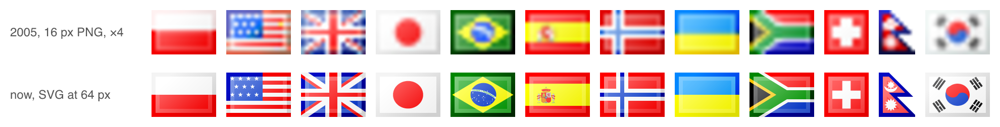
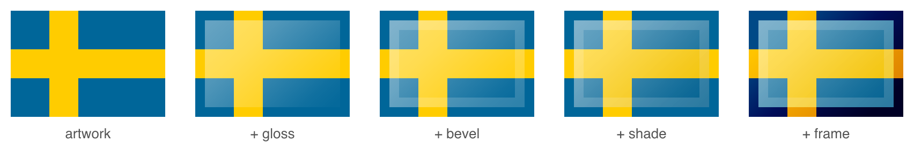

# famfamfam-flags-svg

[](https://www.npmjs.com/package/famfamfam-flags-svg)
[](https://github.com/jakuborlowski/famfamfam-flags-svg/actions/workflows/ci.yml)
[](LICENSE)



[Mark James' famfamfam flag icons](https://web.archive.org/web/20201209062923/http://www.famfamfam.com/lab/icons/flags/),
rebuilt as SVG: the same 16×11 footprint, glossy bevel and punchy palette,
sharp at any size. An unofficial rebuild, generated from real flag artwork.

**<!-- count -->274 flags in 281 files<!-- /count -->** · every ISO 3166-1 country · the 2005 file names · today's designs · about 3 KB each

**[Browse the gallery](https://jakuborlowski.github.io/famfamfam-flags-svg/preview.html)**: search, any size, dark background, click to copy.

<!-- llms -->
## Use

Pick one.

**A flag on its own**: an ``, named by its `alt`. No stylesheet.

```html

```

**A flag beside its name**: the stylesheet once per page, then a class. The
name is right there, so the flag is hidden from screen readers. A code
without a flag shows `xx`, the unknown flag.

```html
<link rel="stylesheet" href="https://cdn.jsdelivr.net/npm/famfamfam-flags-svg@0.2.1/dist/famfamfam-flags.css" integrity="sha384-31eI4DSJ74sjRnOQ9v/QfCYwP0bnWKuqc0KZ8/xa832wXxfk+gs9CBqJNVMGckmZ" crossorigin="anonymous">

<span class="famfamfam-flags pl" aria-hidden="true"></span> Poland
```

**In a JavaScript app**: `npm install famfamfam-flags-svg` and render an
`` in both cases, its `alt` the name on its own and `""` beside it.
`flagUrl` gives the URL at the installed version.

```ts
import { flagUrl, isFlagCode } from "famfamfam-flags-svg";

flagUrl("pl");            // https://cdn.jsdelivr.net/npm/famfamfam-flags-svg@0.2.1/dist/svg/pl.svg
flagUrl("pl", "/flags/"); // your own copy of dist/svg: /flags/pl.svg

// A code from data, "PL" or "pl". At runtime one without a flag gives xx;
// TypeScript asks for the check, and makes a mistyped literal an error.
flagUrl(isFlagCode(order.country) ? order.country : "xx");
```

Recipes, each run in a browser by CI: plain HTML ([page](examples/html/index.html)),
email ([page](examples/email/index.html)), Jinja for Flask or Django
([macro](examples/jinja/flags.html), [page](examples/jinja/orders.html)) and
React ([component](examples/react/Flag.tsx), [page](examples/react/Orders.tsx)).

<!-- cost -->The stylesheet is 16.1 KB, 1.9 KB gzipped, and fetches only the flags a page shows.<!-- /cost --> A flag is
about 3 KB, 1 KB gzipped. jsDelivr serves every file `immutable`, with
CORS `*`.
<!-- /llms -->

## Good to know

| | In short |
| --- | --- |
| **Codes** | Lowercase ISO 3166-1 alpha-2, in file names and classes. `PL.svg` is a 404; `flagUrl` takes either case. |
| **Beyond countries** | Regions and organisations have codes too: `gb-sct`, `es-ct`, `eu`, `un` and [more](docs/guide.md#codes). |
| **United Kingdom** | `gb`. `uk` works too, as a file and as a class, and so does `el` for Greece. |
| **Unknown code** | The stylesheet and `flagUrl` show `xx`, a white flag crossed out. A bare `` would be a 404. |
| **Sizes** | 16×11, except `ch` 11×11 and `np` 9×11, so set only `height`. Crisp at whole multiples: 11, 22, 33 or 44 px tall. |
| **In a column** | Switzerland and Nepal are narrower, so names beside them don't line up: [give every flag the same box](docs/guide.md#sizes). |
| **Scaling classes** | `--famfamfam-flags-scale: 2` in your own stylesheet. |
| **Accessibility** | On its own, the country's name as `alt`. Beside its name, `alt=""` or `aria-hidden="true"`. |
| **CSP** | `img-src https://cdn.jsdelivr.net`, and `style-src` too for the stylesheet. Nothing is inline. |
| **Email** | Give `width` and `height`. Outlook 2016 and older need the PNGs from the release zip. |
| **Languages** | There is no `en` flag: languages aren't countries. |

The **[guide](docs/guide.md)** has the detail and the rest: [codes](docs/guide.md#codes) · [sizes](docs/guide.md#sizes) · [accessibility](docs/guide.md#accessibility) · [names in the user's language](docs/guide.md#names-in-the-users-language) · [CSP](docs/guide.md#content-security-policy) · [email](docs/guide.md#email) · [self-hosting](docs/guide.md#self-hosting) · [moving from the classic famfamfam-flags](docs/guide.md#coming-from-famfamfam-flags) · [the manifest](docs/guide.md#manifest).

Working with an agent? Hand it [llms.txt](llms.txt): the snippets and the guide in one file.

## Guarantees

- **Stable names.** Files never move from `dist/svg/<code>.svg`; aliases are
  real files, not redirects; retired codes stay.
- **Every country.** Every ISO 3166-1 alpha-2 code has a file.
- **Safe to inline.** A `<title>`, ids prefixed with the code, and no
  scripts, styles, text, images, filters or external references.
- **Small.** Most flags are about 3 KB. Emblems are reduced to 8 KB under a
  measured render-error bound; the 11 that can't be are listed in
  `src/oversize.json`, the largest at 21 KB.
- **Crisp, with no gaps.** Frame, bevel, band edges and thin stripes sit on
  whole pixels at 1×, and every pixel is opaque at 1×, 2× and 4×, on light
  and dark pages.
- **Docs that match the package.** Every version, hash and figure in the
  snippets comes from the build, and CI opens every recipe in headless
  Chrome under a strict Content Security Policy, with axe.

`npm test` checks all of these but the last, which is `npm run examples`.

## How the look is made



Every icon is `style(artwork, icon box)`: nothing is drawn twice, so 274
flags share one look to the byte. The style was measured, not eyeballed. The
originals all carry the same overlay, so it was read off every one of them
at once and fitted by least squares to 0.6/255 RMS:

| Layer | What it does |
| --- | --- |
| Gloss | white, 40% at the top-left fading to 2% at the bottom-right |
| Bevel | the 1 px ring inside the frame gets a constant extra 16% white |
| Shade | up to 6% black towards the bottom-right |
| Frame | the flag's own edge colours, colour-burned and darkened along the diagonal |

The colours turned out to have a source. Mark picked most of them from the
[Flags of the World](https://www.fotw.info/flags/fotwcols.html) images of
2005, drawn in a 32-colour web-safe palette: every red `#FF0000`, every
green `#009900`. Archived copies match his icons flag by flag, and the build
snaps onto that palette. Artwork comes from
[flag-icons](https://github.com/lipis/flag-icons), stretched to the icon as
the originals were. The scripts and notes are in [`research/`](research/).

Where it differs from 2005: flags that changed since show today's design;
fine stripes and crosses (`us`, `gb`, the Nordic flags, Nepal) are drawn on
the pixel grid, as Mark did by hand; Montenegro is 16×11, not 16×12.

## Building

```sh
npm ci            # Node 20 or newer
npm run build     # src -> dist/svg, about a minute
npm run pack      # stylesheet, manifest, JS entry, gallery, llms.txt; pins the docs
npm test          # the guarantees above
npm run examples  # the recipes in headless Chrome (needs Chrome, and Python with Jinja2)
npm run compare   # error against the originals, and a side-by-side sheet in tmp/
```

[AGENTS.md](AGENTS.md) describes the pipeline and how to add a flag,
[CHANGELOG.md](CHANGELOG.md) records every flag change by code, and
[ROADMAP.md](ROADMAP.md) says where this is going.

## Credits

Original icons by Mark James, public domain (`gg` add-on by Damien Guard,
CC BY 2.5). Flag artwork from [flag-icons](https://github.com/lipis/flag-icons)
by Panayiotis Lipiridis, MIT, and six public-domain Wikimedia Commons files.
This rebuild is MIT; details in [LICENSE](LICENSE).

See also [famfamfam-silk-svg](https://github.com/Simandara/famfamfam-silk-svg),
the Silk icons redrawn by hand as SVG, and
[famfamfam-flags](https://github.com/legacy-icons/famfamfam-flags), the
original PNGs, packaged.
