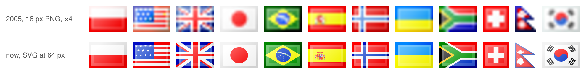

# famfamfam-flags-svg



An unofficial rebuild of [Mark James' famfamfam flag icons](https://web.archive.org/web/20201209062923/http://www.famfamfam.com/lab/icons/flags/)
as SVG. Same 16×11 footprint, same glossy bevelled frame, same punchy
palette, but resolution-independent: crisp at 1×, sharp at 2× and 4×.
<!-- count -->274 flags in 281 files<!-- /count -->: every ISO 3166-1 country, every icon of the
2005 set under its original file name, and current designs wherever a flag
has changed since. [Every flag at four sizes](https://jakuborlowski.github.io/famfamfam-flags-svg/preview.html).

<!-- llms -->
## Use

Pick one.

**A flag on its own**: an ``, named by its `alt`. No stylesheet.

```html

```

**A flag beside its name**: the stylesheet once per page, then a class. The
name is right there, so the flag is hidden from screen readers. A code
without a flag shows `xx`, the unknown flag.

```html
<link rel="stylesheet" href="https://cdn.jsdelivr.net/npm/famfamfam-flags-svg@0.2.0/dist/famfamfam-flags.css" integrity="sha384-rugFcdY6hZ97GbJAmbATGc0J+K7D32P2dWlm7j+7OBNePsJiqQ3yaGi4saQ3Zw2j" crossorigin="anonymous">

<span class="famfamfam-flags pl" aria-hidden="true"></span> Poland
```

**In a JavaScript app**: `npm install famfamfam-flags-svg` and render an
`` in both cases, its `alt` the name on its own and `""` beside it.
`flagUrl` gives the URL at the installed version.

```ts
import { flagUrl, isFlagCode } from "famfamfam-flags-svg";

flagUrl("pl");            // https://cdn.jsdelivr.net/npm/famfamfam-flags-svg@0.2.0/dist/svg/pl.svg
flagUrl("pl", "/flags/"); // your own copy of dist/svg: /flags/pl.svg

// A code from data, "PL" or "pl". At runtime one without a flag gives xx;
// TypeScript asks for the check, and makes a mistyped literal an error.
flagUrl(isFlagCode(order.country) ? order.country : "xx");
```

Recipes, each run in a browser by CI: plain HTML ([page](examples/html/index.html)),
email ([page](examples/email/index.html)), Jinja for Flask or Django
([macro](examples/jinja/flags.html), [page](examples/jinja/orders.html)) and
React ([component](examples/react/Flag.tsx), [page](examples/react/Orders.tsx)).

<!-- cost -->The stylesheet is 16.1 KB, 1.9 KB gzipped, and fetches only the flags a page shows.<!-- /cost --> A flag is
about 3 KB, 1 KB gzipped. jsDelivr serves every file `immutable`, with
CORS `*`.

## Rules

* **Codes are lowercase**, in file names and classes, and every file has a
  class: `pl.svg`, `famfamfam-flags pl`, `famfamfam-flags uk`. Data usually
  holds `PL`, and the CDN is case-sensitive: `PL.svg` is a 404. `flagUrl`
  and `isFlagCode` take either case.
* **Every ISO 3166-1 country has a flag**: all <!-- iso -->249<!-- /iso --> alpha-2 codes. The
  United Kingdom is `gb`; `uk` is an alias file, and so is `el` for Greece,
  as EU data (VAT numbers, Eurostat) writes it.
* **An unknown code gets `xx`**, the unknown flag, a white flag crossed out:
  the stylesheet shows it for a class it doesn't know, and `flagUrl` returns
  it. An `` for a code without a file is a 404, so check codes that
  aren't ISO countries against the [manifest](#manifest) first. On its own,
  name it for what it is, as in `alt="Unknown country"`.
* **Codes that aren't ISO countries**, aliases written `uk` = `gb`: <!-- codes -->`an` Netherlands Antilles (1986-2010), `arab` League of Arab States, `asean` Association of Southeast Asian Nations, `catalonia` = `es-ct`, `cefta` Central European Free Trade Agreement, `cp` Clipperton Island, `cs` Serbia and Montenegro (2003-2006), `dg` Diego Garcia, `eac` East African Community, `el` = `gr`, `england` = `gb-eng`, `es-ct` Catalonia, `es-ga` Galicia, `es-pv` Basque Country, `eu` European Union, `europeanunion` = `eu`, `fam` famfamfam, `gb-eng` England, `gb-nir` Northern Ireland, `gb-sct` Scotland, `gb-wls` Wales, `ic` Canary Islands, `pc` Pacific Community, `scotland` = `gb-sct`, `sh-ac` Ascension Island, `sh-hl` Saint Helena, `sh-ta` Tristan da Cunha, `uk` = `gb`, `un` United Nations, `wales` = `gb-wls`, `xk` Kosovo, `xx` Unknown<!-- /codes -->.
* **Sizes**: 16×11, except `ch` 11×11 and `np` 9×11. Give an `` only a
  `height` and the width follows. Flags are crisp only at whole multiples:
  11, 22, 33 or 44 px tall. Don't size them in `em`. To scale the classes,
  set `--famfamfam-flags-scale` in your own CSS, as in
  `.partners .famfamfam-flags { --famfamfam-flags-scale: 2 }`, not in a
  `style` attribute, which strict CSPs block. Switzerland and Nepal are
  narrower, so names beside them don't line up; to align a column, give
  every flag the same box with the flag at its left:
  `.famfamfam-flags { aspect-ratio: 16 / 11; background-position: left }`,
  or `width: 16px; object-fit: contain; object-position: left` on an ``.
* **Browsers**: `` works in any. The stylesheet needs cascade layers
  and `aspect-ratio`, which every major browser has had since 2022 (Safari
  15.4, Chrome 99, Firefox 97); in older ones its flags don't show.
* **Accessibility**: a flag on its own gets the country's name as its `alt`;
  a flag beside its name gets `alt=""`, or `aria-hidden="true"` on the span.
  A `title` adds a tooltip, worth it on a flag alone: at 16 px Lithuania and
  Bolivia look alike. To name a flag, use an ``, not a span with
  `role="img"` or `aria-label`. An inlined SVG is named by its `<title>`;
  beside its name, give the `<svg>` `aria-hidden="true"`.
* **Names in the user's language**: don't ship translations; the platform
  has them for two-letter ISO codes. In JavaScript,
  `new Intl.DisplayNames([lang], { type: "region", fallback: "none" }).of(code.toUpperCase())`,
  which throws on longer codes such as `gb-sct`; in Python, Babel's
  `Locale.parse(lang, sep="-").territories.get(code.upper())`. Neither knows
  `el` (ask for `GR`), and Intl names the retired `an` and `cs` after their
  successors. Where they give nothing, use the English `name` from the
  manifest, or `flags[code]?.name` in JavaScript, as the
  [React page](examples/react/Orders.tsx) does.
* **Content Security Policy**: with `default-src 'none'`, an `` needs
  `img-src https://cdn.jsdelivr.net`, and the stylesheet also
  `style-src https://cdn.jsdelivr.net`; its flags load under `img-src`.
  Self-hosted, both are `'self'`. Nothing is inline, unless a bundler
  inlines an imported flag as a `data:` URL, which `img-src` must then allow.
* **Email**: Gmail (which converts SVG to PNG), Outlook 2019 and later,
  Outlook.com, Apple Mail and most other clients show the SVGs
  ([caniemail](https://www.caniemail.com/features/image-svg/), tested
  September 2026). Clients ignore CSS sizes, so give both:
  ``,
  with `width="11"` for `ch` and `width="9"` for `np`. Outlook 2016 and
  older and Mail.ru don't show SVG; to reach them, host the PNGs from the
  [release zip](https://github.com/jakuborlowski/famfamfam-flags-svg/releases/latest/download/famfamfam-flags-svg.zip)
  yourself.
* **Languages aren't countries**: there is no `en` flag. Which flag stands
  for a language, `gb` or `us` for `en`, is a product decision.
<!-- /llms -->

## Self-hosting

Hosting the files yourself saves a production site a third-party request.
Take `dist/` from the [latest release](https://github.com/jakuborlowski/famfamfam-flags-svg/releases/latest/download/famfamfam-flags-svg.zip)
(SVGs, PNGs at 1×, 2× and 4×, the stylesheet, the JS entry, the manifest,
the license) or
from npm, `npm install famfamfam-flags-svg`:

| Import | File |
| --- | --- |
| `famfamfam-flags-svg` | `dist/index.js`, with types: `flagUrl(code, base?)`, `isFlagCode(code)`, `flags` (each file's English `name`, `width` and `height`) and `version` |
| `famfamfam-flags-svg/css` | `dist/famfamfam-flags.css`, which loads flags from `svg/` beside it |
| `famfamfam-flags-svg/svg/pl.svg` | one flag, which a bundler may inline as a `data:` URL |
| `famfamfam-flags-svg/manifest.json` | the manifest |

Serve `dist/svg` as static files and pass its URL to `flagUrl`:
`flagUrl("pl", "/flags/")`. A bundler that imports the stylesheet takes
every flag along: Vite inlines each one under 4 KB, which makes your CSS
over half a megabyte. In a bundled app, use `` with `flagUrl`.

## Coming from famfamfam-flags

The [classic PNG package](https://github.com/legacy-icons/famfamfam-flags)
uses the same classes, `class="famfamfam-flags fr"`, and each of its 251
has a file here, so moving over is one stylesheet URL. What changes:

* Spans and `<i>` show up: they become inline blocks, where the classic
  stylesheet left them collapsed unless your CSS gave them a `display`.
  Other elements keep theirs, so a `<div>` stays a block.
* Montenegro is 16×11, not 16×12: a pixel less in your layout. Centring
  11 px of artwork in 12 would put it on half pixels and blur it.
* Guadeloupe and Mayotte, `gp` and `yt`, show their local flags, where the
  classic stylesheet showed France's.
* The stylesheet sits in a cascade layer, so any rule of yours wins over it.
  Load it before your own CSS.
* As with the classic stylesheet, a rule of yours for a bare class like
  `.no` or `.ad` also styles that flag. Use `` there.

## Manifest

Files are named by lowercase ISO 3166-1 alpha-2 code where one exists and
by flag-icons' code otherwise (`gb-sct`, `eu`, `un`). `dist/manifest.json`,
on the CDN at `https://cdn.jsdelivr.net/npm/famfamfam-flags-svg@0.2.0/dist/manifest.json`,
is a JSON array with one entry per file, so you can generate alt text or
check that every country in your data has a flag. An alias file's entry
repeats its flag's fields, name included, and adds `aliasOf`:

| Field | Meaning |
| --- | --- |
| `code`, `name` | file name without `.svg`, and the name used in the file's `<title>` |
| `width`, `height` | icon size: 16×11, except Switzerland 11×11 and Nepal 9×11 |
| `aliases` | other files with the same flag (`uk` for `gb`, and the original set's legacy names) |
| `aliasOf` | on an alias file: the code it is a copy of |
| `legacy` | the flag was in the 2005 set, under this name or another (true for `eu`, whose 2005 file was `europeanunion`, and for `uk`, whose was `gb`) |
| `iconNative` | drawn on the pixel grid rather than scaled from official artwork |
| `note` | why a flag was drawn or chosen the way it was, when that needs saying |

## Guarantees

* **Stable names.** Files will not be renamed or moved from
  `dist/svg/<code>.svg`; aliases are real files, not redirects; retired codes
  stay.
* **Every country.** Every ISO 3166-1 alpha-2 code has a file.
* **Safe to inline.** Every file has a `<title>`, ids prefixed with its code
  so any number can share one document, and no scripts, styles, text,
  images, filters or external references.
* **Small.** Most flags are about 3 KB. Emblem flags are held to 8 KB by
  reducing geometry under measured render-error bounds, overall and in every
  small area so no emblem is lost; the 24 that still exceed it are listed in
  `src/oversize.json`, the largest at 51 KB.
* **Crisp at 1×.** The frame and bevel sit on whole pixels, band edges and
  thin stripes land on whole pixels as in the originals, and flags whose
  official artwork cannot survive 16 px (the US stripes, the Nordic crosses,
  the Union Jack) are drawn on the pixel grid the way the originals were.
* **No gaps or seams.** Every pixel of every icon is opaque at 1×, 2× and
  4×, on light and dark pages: the artwork is painted three times so
  neighbouring shapes never let the page show through between them. (Pages
  that inline hundreds of flags get three references to each artwork.)
* **Docs that match the package.** The version and SRI hash in every snippet,
  and the figures around them, come from the build. CI opens every recipe in
  headless Chrome under the Content Security Policy stated above: every flag
  request must succeed, every flag must draw at its size, and axe must find
  nothing.

`npm test` checks all of these but the last, which is `npm run examples`.

## How the look was reproduced

The originals are flag drawings with one shared layer effect on top: every
icon carries the same overlay, pixel for pixel. That overlay was read off all
the originals at once and fitted by least squares to 0.6/255 RMS. In
`tools/style.js`, all along a 47.5° diagonal:

| Layer | What it does |
| --- | --- |
| Gloss | white, 40% at the top-left fading to 2% at the bottom-right |
| Bevel | the 1 px ring inside the frame gets a constant extra 16% white |
| Shade | up to 6% black towards the bottom-right |
| Frame | the flag's own edge colours, colour-burned and darkened along the diagonal |

Colours were the other half, and they turned out to have a source. Mark
picked most of them from the [Flags of the World](https://www.fotw.info/flags/fotwcols.html)
reference images of 2005, which were drawn in a 32-colour web-safe palette:
every red `#FF0000`, every green `#009900`, every yellow `#FFFF00` unless the
contributor coded it "dark yellow", `#FFCC00`. Archived copies of those images
match his colours flag by flag. His blues he mostly brightened by hand, so
navies read as blue at 16 px. `tools/color.js` snaps saturated reds,
oranges, yellows, greens and blues onto that palette and maps everything else
smoothly; the catalog records the per-flag choices that came from the 2005
images, such as dark yellow, the darkest navies and the exact blues. `FAM_COLORS=official` keeps
official colours. The scripts and notes behind all of this are in `research/`.

The frame is the one layer that depends on the artwork. Mark's frame darkens
mid tones far harder than bright ones, a colour burn, which keeps his frames
deep red, forest green and navy rather than grey. Blend modes would need a
`style` attribute, which strict Content Security Policies strip, so the build
bakes it instead: it repaints the flag's own shapes inside the frame, each
colour with its frame ramp, fitted on Mark's frame pixels to 4.9/255
(`research/fit_frame.py`, `tools/frame.js`). Diagonals and waves run on into
the frame at any size, and a border thinner than a pixel, like Guam's or Sri
Lanka's, becomes the frame, as in the originals.

Artwork comes from [flag-icons](https://github.com/lipis/flag-icons), stretched
to fill the icon as the originals were, then flattened into the 16×11
coordinate space and reduced with every step verified by rendering. Flags
flag-icons does not carry are in `src/flags`.

## Differences from the 2005 set

* Current designs where a flag changed (Lesotho, Libya, Myanmar, Syria,
  Martinique 2023, and others).
* `us`, `um`, `lr`, `my`, `gr`, `uy`, `dk`, `se`, `no`, `fi`, `is`, `fo`, `ax`
  and `gb` are drawn on the pixel grid; stripe counts and cross proportions
  are the icon's, not the official ones, exactly as Mark did it.
* French overseas territories follow the original: local flags for
  Guadeloupe, Saint Pierre and Miquelon, Wallis and Futuna and Mayotte, the
  tricolour for Réunion and French Guiana. Guadeloupe uses the widely used
  black-and-sun local flag; the original icon showed an independence-movement
  flag.
* Montenegro is 16×11 (the original was 16×12).

## Building

```sh
npm ci            # Node 20 or newer
npm run build     # src -> dist/svg, about 30 s
npm run pack      # stylesheet, manifest, JS entry, preview.html, llms.txt; pins README and examples
npm test          # the guarantees above
npm run examples  # the recipes in headless Chrome (needs Chrome, and Python with Jinja2)
npm run png       # dist/png at 1×, 2×, 4× (not committed; in the release zip)
npm run compare   # error vs the originals plus a side-by-side sheet in tmp/
```

`AGENTS.md` describes the pipeline and how to add or update a flag.
`CHANGELOG.md` records every flag change by code.

## See also

* [famfamfam-silk-svg](https://github.com/Simandara/famfamfam-silk-svg): the
  Silk icon set redrawn by hand as SVG.
* [flag-icons](https://github.com/lipis/flag-icons): the artwork this set is
  built from, in its own flat style.
* [famfamfam-flags](https://github.com/legacy-icons/famfamfam-flags): the
  original PNGs, packaged.

## Credits and license

Original icons: Mark James, public domain (`gg` add-on by Damien Guard, CC BY 2.5).
Flag artwork: flag-icons by Panayiotis Lipiridis, MIT. Six flags from
public-domain Wikimedia Commons files. This rebuild: MIT. Details in `LICENSE`.
